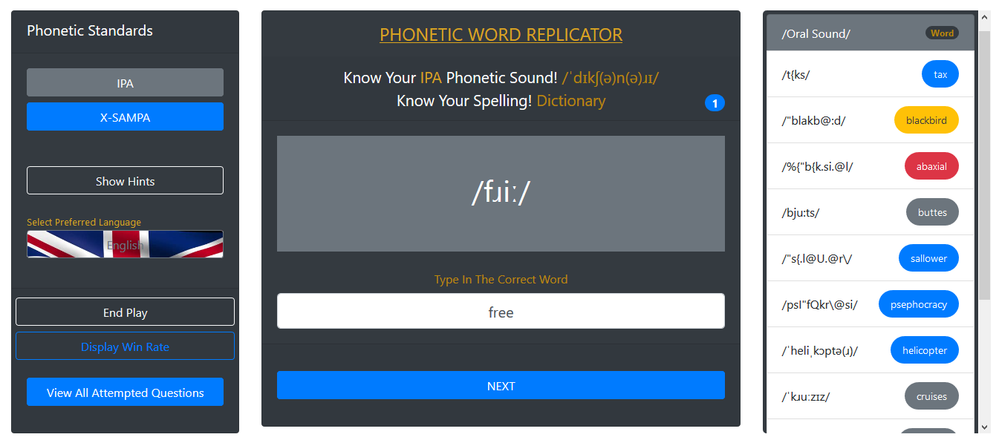
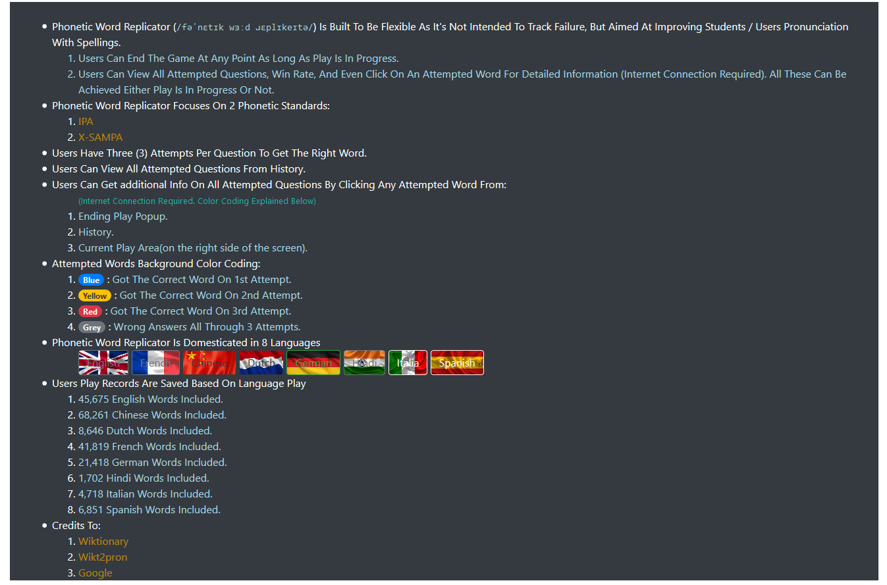

# Phonetic Word Replicator

<h1 align="center">
  <a href="public/img/Phonetic-Word-Replicator(0).png"></a>
  <a href="public/img/Phonetic-Word-Replicator(1).png"></a>
</h1>

<h4 align="center"><code>/fəˈnɛtɪk wɜːd ɹɛplɪkeɪtə/</code> · Next.js + TypeScript + React-Bootstrap · v2.0.0</h4>

<blockquote align="center">
    See (or hear) a pronunciation — spell the word it belongs to.
    <em>Phonetic Word Replicator</em> isn't built to track failure; it's built to improve
    students' pronunciation and spelling, one sound at a time.
</blockquote>

---

## What is it?

A browser game that trains spelling through **phonetic transcription**. Every question shows
a word's pronunciation in **IPA** or **X-SAMPA** (switchable any time), and you spell the
word it belongs to — three attempts per word, colour-coded history, and rewards that keep
you coming back.

**8 game languages** with curated Wiktionary pronunciation data:

English (45k words curated to 2,000) · Français · Deutsch · Español · Italiano · Nederlands · हिन्दी · 中文

**5 game modes:**

| Mode | The hook |
|---|---|
| 🔤 **Classic Spelling** | The original challenge — read the sound, type the word. |
| 🃏 **Multiple Choice** | Four options, one right sound-match. A gentle way in. |
| 🎧 **Listen & Spell** | No symbols — the word is spoken aloud (browser TTS). |
| ⚡ **Speed Challenge** | 60 seconds, combo multipliers up to ×3, personal bests. |
| 🗓️ **Daily Challenge** | 10 seeded words — the same puzzle for everyone, every day. |

**Progression that sticks:** XP with combo bonuses, levels, daily streaks, 16 achievements,
and a full stats dashboard (win rates per attempt, per-language breakdowns, daily calendar,
clickable word history linked to Wiktionary).

**Interface localized to 11 languages:** English, Français, Deutsch, Español, Italiano,
Nederlands, हिन्दी, 中文 — plus **Yorùbá, Igbo and Hausa** (community first drafts, in the
spirit of the author's [JS Number To Word Processor](https://github.com/Sidodus) locale work).

## Play

```bash
npm install
npm run dev          # http://localhost:3000
```

Production:

```bash
npm run build        # static export → out/
npm start            # serves out/ on http://127.0.0.1:4173
```

The live game: [sidodus.github.io/phonetic_word_replicator](https://sidodus.github.io/phonetic_word_replicator/)

## How the game works

1. Pick a mode and a language. You're shown a pronunciation — e.g. `/ˈdɪkʃ(ə)n(ə)ɹɪ/` — and
   you type **dictionary**.
2. Three attempts per word: <span>🔵 first-try</span> · <span>🟡 second</span> ·
   <span>🔴 third</span> · ⚪ missed.
3. Hints reveal letters (one per question; every 3 hinted questions cost 15 XP — v1's
   "3 hints = 1 loss" rule, made gentle).
4. Correct answers earn XP; combos multiply the fun; everything is saved in your browser —
   no account, no server.

## Quality

- **TypeScript strict** end to end; the game rules live in a pure, React-free engine.
- **294 tests**: unit (engine, storage, migration, i18n, data contract) + component (every
  mode's play flow) + Playwright E2E smoke on the built site.
- **Coverage gate** ≥ 90% on the engine (`src/lib/**`), enforced in CI.
- **Deterministic data pipeline** — reproducible dictionary packs; CI re-validates them.
- CI: lint · typecheck · pack validation · tests + coverage · static build · E2E.

For agents and contributors: read [AGENTS.md](AGENTS.md) first — it's the operating manual.
Documentation lives in [`docs/`](docs/), decisions in [`docs/adr/`](docs/adr/README.md).

## Project layout

```
src/lib/game/     Pure game engine (state machine, scoring, hints, questions, RNG)
src/lib/storage/  Player profile (Zustand) + one-time v1 data import
src/components/   React-Bootstrap UI (home, play, stats)
messages/         11 UI locale catalogues (en.json canonical)
public/dictionaries/  Generated word packs (8 languages)
scripts/          Dictionary curation pipeline
data/raw/         Source Wiktionary data (build-time only)
legacy/           Frozen 2019 vanilla-JS original (reference only)
docs/             Architecture, data pipeline, game design, i18n, migration, ADRs
```

## Credits

Created by **Saheed Odulaja** ([Sidodus](https://github.com/Sidodus)) as a 2019 JavaScript
coding exercise, rebuilt in 2026 as v2.

- Dictionary data: [Wiktionary](https://wiktionary.org) — parsed pronunciation data via
  [wikt2pron](https://github.com/abuccts/wikt2pron). Attempted words link to Wiktionary for
  definitions.
- Yorùbá/Igbo/Hausa interface drafts continue the locale work from the author's
  JS Number To Word Processor; native-speaker review is welcome.

MIT licensed — see [LICENSE](LICENSE).
